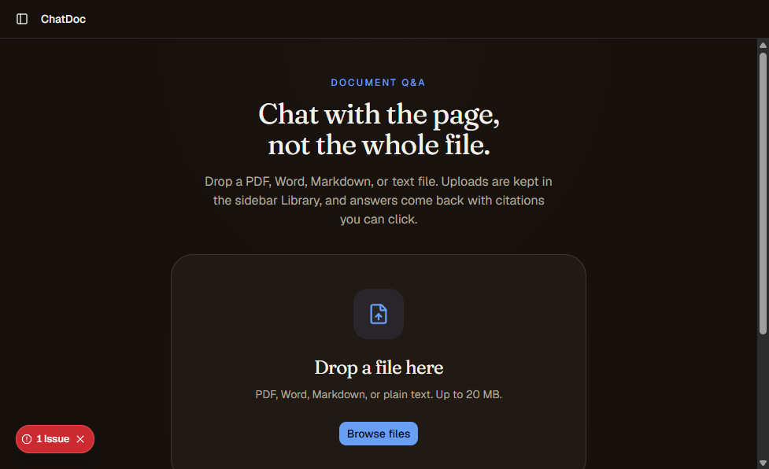
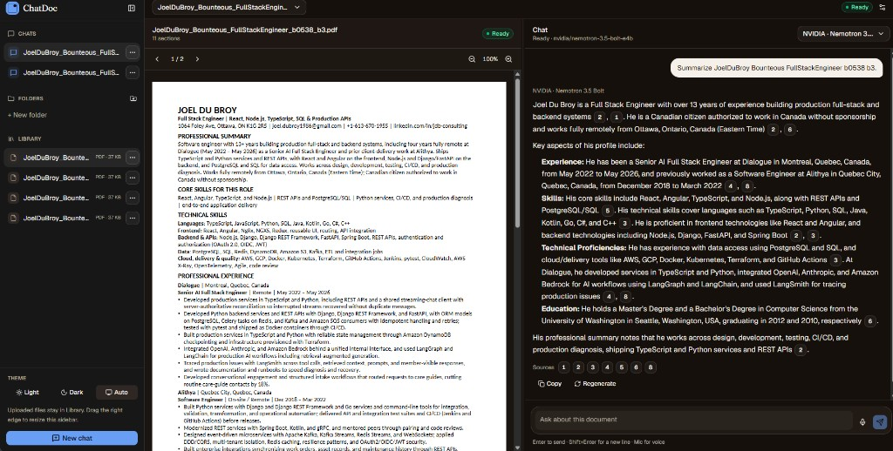
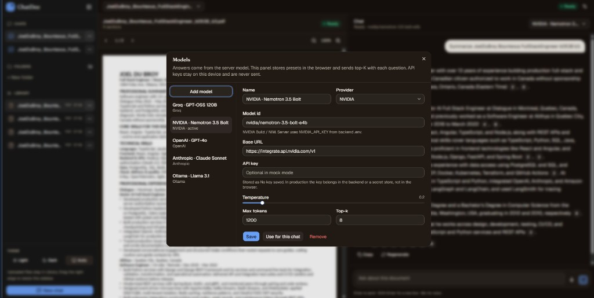

# Knowledge Assistant — Chat With Your Docs

**Assignment option:** Option 1 — conversational RAG over uploaded documents (PDF, DOCX, Markdown, plain text).

Upload internal docs → ask questions → get **cited** answers. Citations jump into a split-pane document viewer.

Extra walkthrough (architecture + API): open [`docs/index.html`](docs/index.html) in a browser.

### Why I built it this way

The thing I care about most in a doc Q&A tool is trust. If I can't see where an answer came from, I don't believe it. So every answer has numbered citations, and one click opens the exact passage in the document. If the retrieved text doesn't support an answer, the app says so instead of guessing.

I kept the stack boring on purpose: one Postgres for documents, chunks, chats and vectors, one small FastAPI service, and one worker for ingestion. The extra retrieval steps (query rewrite, dual-query, neighbor expansion) are all switches in `.env`, so you can turn them off and still have a plain hybrid-search RAG.

---

## Quick setup

### Prerequisites

- Docker + Docker Compose
- An LLM API key (Groq via the OpenAI-compatible API by default; NVIDIA Build / OpenAI / Anthropic / Gemini / DeepSeek / Ollama also work)

### Run (recommended)

```bash
cp .env.example .env
# set OPENAI_API_KEY (Groq key by default), or switch provider — see Configuration
docker compose -f docker-compose.yml up -d --build
```

| Service | URL |
|---------|-----|
| App | http://localhost:3000 |
| API | http://localhost:8000 |
| OpenAPI | http://localhost:8000/docs |

### Usage

1. Open http://localhost:3000  
2. Drop a PDF / DOCX / Markdown / text file (or **Try the sample brief**)  
3. Wait until status is **ready**  
4. Ask a question → click a citation to jump to that passage  

### Dev mode (hot reload)

```bash
docker compose -f docker-compose.yml -f docker-compose.dev.yml up -d --build
```

### Useful commands

```bash
make up            # light stack
make logs
make test-backend
make test-frontend
make lint
make db-migrate
make backend-shell
```

### Screenshots

| Shot | File | Shows |
|------|------|--------|
| Landing | `docs/screenshots/landing.png` | Upload dropzone + sample brief |
| Workspace | `docs/screenshots/workspace-citation.png` | Chat + viewer + citation highlight |
| Models | `docs/screenshots/model-settings.png` | Provider / model / temperature |







---

## Architecture overview

```
┌─────────────┐   upload    ┌──────────┐  enqueue   ┌────────────┐
│  Next.js UI │────────────▶│  FastAPI │───────────▶│ Celery     │
│  (viewer +  │◀── SSE ─────│  /api/v1 │            │ (Redis)    │
│   citations)│             └────┬─────┘            └─────┬──────┘
└─────────────┘                  │                        │
                                 │                   parse→chunk
                                 │                   →embed→store
                                 ▼                        ▼
                          ┌─────────────────────────────────────┐
                          │ PostgreSQL 16 + pgvector + FTS      │
                          └─────────────────────────────────────┘

Ask path:
  question → (optional rewrite) → dense (pgvector) + sparse (FTS)
           → RRF fuse → neighbor expand → refuse OR stream cited answer (LiteLLM)
```

### Tech stack

| Layer | Choice |
|-------|--------|
| Frontend | Next.js, TypeScript, Tailwind (PDF/DOCX viewer, SSE chat, citation jump) |
| API | FastAPI (async SQLAlchemy) |
| DB | PostgreSQL 16 + **pgvector** + **full-text search** |
| Queue | Celery + Redis |
| LLM | LiteLLM (NVIDIA / OpenAI-compatible / DeepSeek / Anthropic / Ollama) |
| Embeddings | Local `sentence-transformers` — `all-MiniLM-L6-v2` (384-d) |

### Repo layout

```
chat-doc/
├── docker-compose.yml
├── Makefile
├── docs/                 # product walkthrough + screenshots
├── backend/
│   ├── app/
│   │   ├── api/          # REST + SSE
│   │   ├── models/
│   │   ├── services/     # ingest, chunk, retrieve, chat, LLM
│   │   ├── tasks/        # Celery document pipeline
│   │   ├── evals/        # golden-case runner
│   │   └── middleware/   # logging, rate limit
│   ├── alembic/
│   └── tests/
└── frontend/
    ├── app/
    ├── components/
    ├── hooks/
    └── lib/
```

---

## RAG / LLM approach & decisions

### What I considered vs what I shipped

| Concern | Options considered | Final choice | Why |
|---------|-------------------|--------------|-----|
| **Vector store** | Dedicated vector DB (Qdrant/Pinecone), FAISS-in-process, Postgres+pgvector | **Postgres + pgvector** | One operational surface for docs, chunks, chats, and vectors; easy Docker story; good enough for assignment scale |
| **Sparse retrieval** | Dense-only, BM25 library, Postgres FTS | **Postgres FTS + RRF** | Catches exact codes / rare tokens dense MiniLM misses; RRF is simple and robust |
| **Embeddings** | OpenAI embeddings, larger local models | **all-MiniLM-L6-v2 local** | No embedding API cost/latency; 384-d fits pgvector; worker/API warm the model once |
| **LLM** | Single vendor lock-in | **LiteLLM multi-provider** | Swap NVIDIA / Groq / OpenAI / DeepSeek / Ollama via env without rewriting chat |
| **Orchestration** | LangChain / LlamaIndex agents | **Thin custom pipeline** | Controllable retrieval + refusal; fewer opaque abstractions for debugging |
| **Chunking** | Fixed windows only | **Section-aware + size/overlap + contextualize** | Headings/roles become retrieval units; filename/section/page prepended so chunks stay attributable |
| **Prompt / context** | Stuff top-k blindly | **Rewrite → retrieve → refuse gate → cite-only SSE** | Prefer silence over hallucination; citations filtered to markers the model actually used |
| **Guardrails** | Prompt-only “don’t invent” | **Retrieval refusal + weak-answer retry + rate limit** | Prompt alone is weak; score/overlap gates + IP rate limit |
| **Quality** | Manual eyeballing only | **Golden evals endpoint** + unit tests around retrieval/chat | Cheap regression signal for hit@k / refusal / must-contain phrases |
| **Observability** | Full APM | **Structured request logs + `/health` + per-answer meta** (scores, overlap, latency, model) | Enough to debug RAG without standing up a telemetry stack |

### Ask path (detail)

1. Persist user message; load short conversation history  
2. `prepare_retrieval_query` — expand/rewrite follow-ups when enabled; fall back to original on LLM failure  
3. Hybrid retrieve: dense + sparse → RRF; optional dual-query (original ∪ rewritten); neighbor window; section diversification  
4. If evidence overlap is weak, widen pool once  
5. If refusal gate trips → canned refusal, no fake citations  
6. Else stream answer with `[n]` citations; strip unused sources; retry once on false “not in document” answers  

### Tunables (`.env`)

```bash
CHUNK_SIZE=800
CHUNK_OVERLAP=120
DENSE_TOP_K=20
SPARSE_TOP_K=20
FINAL_TOP_K=8
RRF_K=60
RETRIEVAL_THRESHOLD=0.18
DENSE_MIN_SCORE=0.22
DUAL_QUERY_RETRIEVE=true
REWRITE_ENABLED=true
```

Evals (after documents are ready):

```bash
curl -X POST http://localhost:8000/api/v1/workspaces/WORKSPACE_ID/evals/run
```

---

## Key technical decisions (and why)

1. **Ingestion runs in a Celery worker, not in the upload request.** Parsing and embedding a big PDF takes time. I didn't want uploads to time out, so the API just saves the file and queues the job. The worker runs with `concurrency=1` because MiniLM is loaded in memory and I'd rather be slow than crash.
2. **Hybrid search (vector + Postgres full-text) with RRF.** Internal docs are full of codes and exact names like `ERR-4402`. Vector search alone is soft on those. Full-text search catches them, and RRF merges both lists without any tuning.
3. **Citations are part of the product, not a footnote.** The server keeps stable `[n]` numbers, drops sources the model didn't actually use, and the UI only shows a citation chip when there is a real passage behind it.
4. **Chat is scoped to one document in the UI.** It keeps answers from mixing content across files during a demo. The API still supports workspace-wide search when needed.
5. **Embeddings run locally, the LLM is remote.** Embedding is high-volume and repetitive, so a small local model saves cost and latency. Answer quality depends on the LLM, so that part uses a hosted model.
6. **One `docker compose up` for the reviewer.** I wanted anyone to run the full stack with one command. Hot reload lives in a separate `docker-compose.dev.yml` so the default stays simple.
7. **No login in this version.** Auth would have taken most of my time without showing anything about RAG. I describe what production auth needs in the next section.

---

## What productionization on a hyper-scaler would require

This Compose stack is a **single-node prototype**. To deploy on AWS / GCP / Azure / Cloudflare (or mix):

| Area | Today | Production |
|------|--------|------------|
| **Compute** | Compose services | API + worker as containers on ECS/Fargate, GKE/Cloud Run, ACA, or Cloudflare Containers/Workers for the edge BFF; autoscale workers on queue depth |
| **Data** | Local Postgres volume | Managed Postgres with pgvector (RDS/Cloud SQL/Azure DB) or dedicated vector service; automated backups, PITR |
| **Redis** | Single Redis container | Managed Redis (ElastiCache / Memorystore / Azure Cache) with HA |
| **Object storage** | Local `uploads/` volume | S3 / GCS / Azure Blob / R2; signed URLs for download; virus scan on upload |
| **AuthN/Z** | None | SSO/OIDC; workspace ACLs; per-tenant isolation on documents and embeddings |
| **LLM** | Env API keys | Secret Manager / KMS; per-tenant budgets; provider failover; PII redaction before prompt |
| **Networking** | Open localhost ports | Private subnets, WAF, TLS, CORS locked to real origins |
| **Observability** | Logs + `/health` | OpenTelemetry traces, RAG metrics (retrieval hit rate, refusal rate, p95 latency), alerting |
| **CI/CD** | Manual | Build/test/migrate pipeline; blue-green or canary; migration gates |
| **Edge / CDN** | None | Cloudflare/CloudFront for static Next assets; cache public marketing docs only |
| **Compliance** | — | Retention, audit log of prompts/answers, region pinning |

Minimal credible path: **managed Postgres+pgvector + object storage + containerized API/worker + secrets + auth**, then add observability and multi-tenant ACLs.

### The path I'd take first: Azure

| Piece | Azure service |
|-------|---------------|
| Next.js frontend, FastAPI API, Celery worker | Azure Container Apps (worker scales on Redis queue length via KEDA) |
| Images | Azure Container Registry |
| Postgres + pgvector + FTS | Azure Database for PostgreSQL Flexible Server (`vector` extension enabled) |
| Redis | Azure Cache for Redis |
| Uploaded files | Azure Blob Storage (private container, SAS URLs for the viewer) |
| Secrets / LLM keys | Azure Key Vault + managed identity |
| Auth | Microsoft Entra ID (OIDC) |
| LLM | Azure OpenAI as one more LiteLLM provider, keeping the others for failover |
| Observability | Azure Monitor / Application Insights via OpenTelemetry |
| Edge | Azure Front Door + WAF |

Because the app already runs as containers with env-based config, the move is mostly infrastructure (Bicep or Terraform), not app code; the main code change is replacing the local `uploads/` volume with Blob Storage.

---

## Engineering standards followed (and some I skipped)

### Followed

- Clear service boundaries (`api` / `services` / `tasks` / `models`)  
- Typed settings via pydantic; Alembic migrations  
- Dockerized local path; Makefile for common ops  
- Backend tests (pytest) + frontend unit tests (vitest); Playwright is installed but e2e specs are not written yet  
- Lint: ruff (backend), eslint/prettier (frontend)  
- CI on every push and PR (GitHub Actions): backend ruff + pytest against a pgvector service, frontend lint + unit tests + build  
- Rate limiting on chat-ish traffic; request logging middleware  
- Refusal / citation hygiene instead of “always answer”  
- `.env.example` without secrets; `.env` gitignored  

### Skipped / deferred (on purpose)

- **Auth and multi-tenancy** — would dominate schedule; documented for production  
- **Full OpenTelemetry / metrics dashboards** — health + answer meta instead  
- **Horizontal worker autoscaling & GPU embedding service** — concurrency=1 is honest for MiniLM memory  
- **Exhaustive PDF layout / OCR** — text-extractable PDFs only; scanned docs are an acknowledged edge  
- **Perfect project-structure diagram in every doc** — README + `docs/index.html` cover the walkthrough  

---

## How I used AI coding tools

I used Cursor (including its cloud agent) for scaffolding and refactors, and a chat assistant to compare design options and review this README. The decisions about retrieval, refusal and what to ship were mine.

**What I let AI do:**
- Write boilerplate: FastAPI routers, React components, Docker files.
- Give me alternatives (dense-only vs hybrid, LangChain vs a thin pipeline) so I could choose.
- Write tests for behavior I had already defined.
- Look for regressions after I changed chunking or retrieval.

**What I don't let AI do:**
- Change retrieval or refusal logic without me checking the scores myself.
- Invent API endpoints that don't exist in `app/api`.
- Put secrets, `.env` or tool cache folders in the repo.
- Hide important RAG behavior inside a framework I can't read.

**A real example:** the first frontend the Cursor agent made ran against an in-browser mock API by default, with canned passages and answers. It looked good in screenshots, but it proved nothing about retrieval. I kept the mock only as a fallback for UI work and unit tests (`lib/mock/`, used when no API URL is set) and connected the UI to the real FastAPI backend, so every answer and citation in the demo comes from actual retrieval over the uploaded file.

**How I keep it repeatable:** I treat AI output like a pull request from a new teammate. I rename things, delete abstractions I don't need, and keep the flow easy to follow: `chat_service.py`, then `hybrid.py`, then `llm_client.py`. Docker Compose, the Makefile, `.env.example`, the tests and CI are the source of truth. If I can't explain an AI change in this README or cover it with a test, it doesn't go in.

---

## What I’d do differently with more time

1. **Auth + workspace ACLs** and per-user upload quotas  
2. **Reranker** (cross-encoder) after RRF for higher precision at low `FINAL_TOP_K`  
3. **Better PDF pipeline** (layout blocks, tables, OCR fallback)  
4. **Streaming citations earlier** (emit sources as soon as retrieval finishes, before tokens)  
5. **Richer eval suite** (faithfulness / citation accuracy, CI gate on golden set)  
6. **Product polish** — shared workspace chat across docs, export answer+sources, admin reindex UX  
7. **Observability pack** — OTel traces around rewrite / retrieve / generate with dashboards  
8. **Managed deploy recipe** — Terraform/Pulumi for one cloud path documented end-to-end  

Edge cases I’m aware of but didn’t fully harden: scanned PDFs, huge decks, adversarial prompt injection beyond refusal/rate-limit, and multi-lingual retrieval quality with MiniLM.

---

## Configuration

See [`.env.example`](.env.example).

```bash
# Default: Groq via the OpenAI-compatible API
LLM_PROVIDER=openai
LLM_MODEL=openai/openai/gpt-oss-120b
OPENAI_API_KEY=...
OPENAI_API_BASE=https://api.groq.com/openai/v1

# Alternative: NVIDIA Build
# LLM_PROVIDER=nvidia
# LLM_MODEL=nvidia_nim/nvidia/nemotron-3.5-bolt-e4b
# NVIDIA_API_KEY=nvapi-...
# NVIDIA_API_BASE=https://integrate.api.nvidia.com/v1

# Optional Ollama
# docker compose --profile ollama up
# LLM_PROVIDER=ollama
# LLM_MODEL=ollama/llama3.2
```

---

## API (summary)

Base path: `/api/v1`

| Method | Endpoint | Description |
|--------|----------|-------------|
| GET | `/health` | DB / Redis / model readiness |
| POST/GET/PATCH/DELETE | `/workspaces…` | Workspaces |
| POST/GET | `/workspaces/{id}/documents` | Upload / list |
| GET/DELETE | `/documents/{id}` | Detail / delete |
| POST | `/documents/{id}/reindex` | Re-run ingest |
| GET | `/documents/{id}/status` | Processing status |
| GET | `/documents/{id}/file` | Original bytes |
| GET | `/documents/{id}/text` | Pages/passages for viewer |
| GET | `/documents/{id}/suggestions` | Starter questions |
| POST | `/workspaces/{id}/search` | Hybrid search |
| POST/GET/DELETE | `/…/conversations…` | Conversations |
| POST | `/conversations/{id}/chat` | SSE chat (`document_id`, `top_k` optional) |
| POST | `/workspaces/{id}/evals/run` | Golden evals |

---

## License / notes for reviewers

Working local demo: `docker compose up -d --build` → http://localhost:3000.  
Design write-up beyond this README: [`docs/index.html`](docs/index.html).

